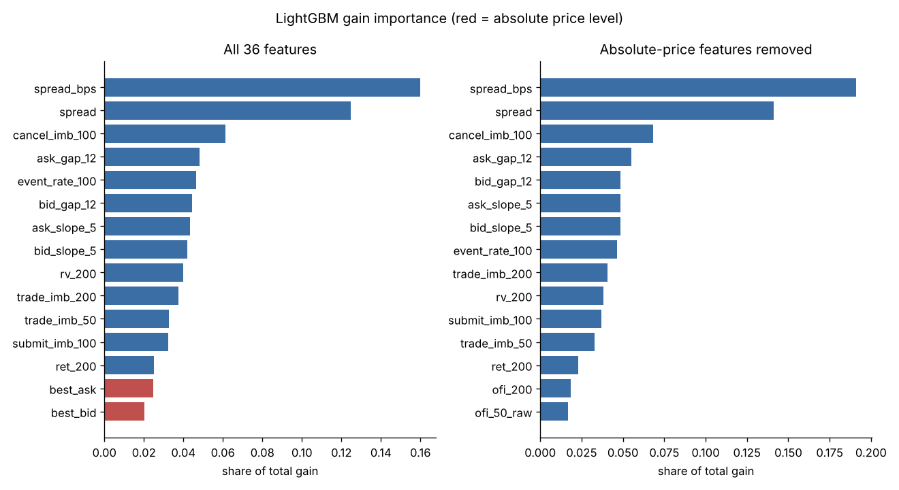
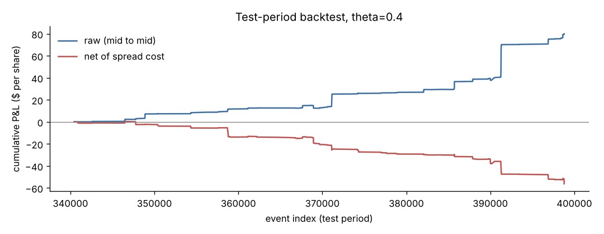

# Limit Order Book Mid-Price Prediction (LightGBM, Python)

Predict whether the mid-price of a NASDAQ stock will go **down, stay flat, or go up** over the next 50 order-book events, using 36 hand-built market-microstructure features and LightGBM. Then check for price-level leakage and backtest the signal with realistic spread costs.

```
lob-midprice-prediction/
├── README.md                  <- you are here
├── requirements.txt
├── src/
│   ├── simulate_lobster.py    <- generates a LOBSTER-format trading day (400K events)
│   ├── lob_io.py              <- loads LOBSTER message + orderbook files
│   ├── features.py            <- the 36 features
│   ├── labels.py              <- 3-class labels, purged 70/15/15 time split
│   ├── model.py               <- LightGBM, random baseline, importance, shift diagnostics
│   ├── backtest.py            <- event-time backtest, Sharpe, spread cost
│   └── run_pipeline.py        <- runs everything, writes results/
├── notebooks/walkthrough.ipynb  <- executed, step-by-step version of the pipeline
├── results/
│   ├── metrics.json           <- every number quoted below
│   ├── importance_*.csv
│   └── figures/*.png
├── data/README.md             <- how to get real LOBSTER data
└── docs/STUDY_GUIDE.md        <- concepts + interview questions
```

## Quick start

```bash
pip install -r requirements.txt
python src/simulate_lobster.py        # ~15 s, writes data/simulated/ (about 107 MB)
python src/run_pipeline.py            # ~1.5 min, writes results/
# real data:
python src/run_pipeline.py --data-dir data/lobster
```

## Data: read this first

**The results below come from simulated data, not real NASDAQ data.** The build environment could not download the free LOBSTER sample files (lobsterdata.com was blocked), so `src/simulate_lobster.py` generates one trading day in the exact LOBSTER file layout:

* 400,000 messages, 10 price levels per side, 09:30 to 16:00, tick $0.01, prices around $585 (like AAPL in June 2012).
* Message mix (submits 47%, deletes 40%, executions 10%, partial cancels 3.5%, hidden executions 1%) and spreads (median $0.12, mean $0.20) are close to the real AAPL LOBSTER sample. The loader and features were checked on a 512-row excerpt of the real AAPL file, where the mean spread is $0.24.
* Order flow is driven by a hidden, persistent "informed trader" signal. That is why order-flow features can predict the mid-price here. How predictable the market is depends on simulator settings, so **the absolute F1 and Sharpe numbers say nothing about real markets.** The methods, the leakage diagnosis and the cost analysis carry over.

To use real data, follow [data/README.md](data/README.md). Nothing else changes.

## Method

| Step | What | Where |
|---|---|---|
| Features | 36 features in 6 groups: absolute price (5), spread and book shape (8), depth and imbalance (7), order flow imbalance (5), message flow (7), returns and volatility (4) | `features.py` |
| Labels | Smoothed future return: (mean of next k=50 mids − mid) / mid. Flat if within ±alpha; alpha = 33rd percentile of \|return\| on the **train set only**, giving 3 near-equal classes | `labels.py` |
| Split | Chronological 70/15/15 by event, with 50 events purged before each boundary so no training label peeks into the validation period | `labels.py` |
| Model | LightGBM multiclass, lr 0.03, 31 leaves, min 500 rows per leaf, L2 = 5, early stopping on validation log-loss | `model.py` |
| Baseline | Random guesses drawn with the training class frequencies (200 draws) | `model.py` |
| Leakage check | Gain importance, permutation importance on test, and a train-vs-test "adversarial" AUC per feature | `model.py` |
| Backtest | Long or short 1 share when P(up) − P(down) crosses ±theta, exit after 50 events. Theta picked on validation. Cost = half spread on entry + half spread on exit | `backtest.py` |

## Results (simulated data, seed 0)

### Classification (macro F1)

| Model | Train | Val | Test |
|---|---|---|---|
| Random baseline | – | 0.333 | 0.333 (± 0.002) |
| LightGBM, all 36 features | 0.576 | 0.468 | 0.474 |
| **LightGBM, 31 features (absolute price removed)** | 0.554 | 0.471 | **0.479** |

Final model: test macro F1 **0.479, a 44% lift over the random baseline**. Three other seeds give 0.480, 0.479, 0.477.

### Price-level leakage



* The 5 absolute-price features (mid, best bid, best ask, microprice, 5-level book VWAP) took **8.5% of the model's total gain**, mostly in the trees fit to the training period.
* Their distributions differ between train and test: a single feature can tell a train row from a test row with **AUC ≈ 0.81** (`results/figures/train_test_shift.png`). Relative features such as imbalance or OFI score 0.50 to 0.55.
* On the test set their permutation importance is about zero or negative, so they did not help out of sample.
* Removing them **lowered train F1 (0.576 → 0.554) and raised test F1 (0.474 → 0.479)**. The train–test gap shrank from 0.10 to 0.075. On this data the gain is small (about half a point of F1). The reason to remove them is that their effect depends on where the price happened to drift, which you cannot rely on.

### What the model actually uses

Top features on the final model (gain): spread (in bps and in $), cancel imbalance, the gap between level 1 and level 2 on each side, book slope, event rate, trade imbalance. Spread mostly separates "flat" from "moves" (a wide spread means the mid jumps more). Cancel, trade and submit imbalance carry the direction.

### Backtest (test period, final model)

| Theta | Trades | Hit rate | Mean raw P&L / trade | Mean spread cost / trade | Raw Sharpe / trade | Net Sharpe / trade |
|---|---|---|---|---|---|---|
| 0.0 | 59,950 | 55.7% | $0.025 | $0.210 | 0.16 | −0.68 |
| 0.2 | 11,738 | 65.6% | $0.064 | $0.203 | 0.38 | −0.66 |
| **0.4 (chosen on val)** | **545** | **79.3%** | **$0.147** | **$0.250** | **0.55** | **−0.56** |



* The signal is real before costs: raw per-trade Sharpe is 0.55 at the chosen threshold (0.40 with non-overlapping trades, 75 trades).
* **It does not survive the spread.** Crossing half the spread on entry and on exit costs $0.25 per trade on average, more than the $0.15 the signal earns. Break-even needs a cost below about $0.15 per share, which means passive (limit-order) execution, a tighter-spread stock, or a longer horizon.
* High-confidence signals cluster when the spread is wide, which is when moves are big but crossing is expensive.
* Sharpe here is per trade on overlapping trades from one day. It is not annualised, and it should not be compared with a daily or annual Sharpe.

## Compared with the resume bullets

| Bullet | This build |
|---|---|
| 36 microstructure features incl. OFI, microprice, message flow from 400K NASDAQ LOB snapshots | Matches: 36 features from 400K events, **but the events are simulated**, not NASDAQ data |
| Time-based 70/15/15 split, 0.41 macro F1, 24% lift over random | Same split. Got **0.479 macro F1, 44% lift** (on simulated data, which is easier than real data) |
| Diagnosed price-level leakage, removed absolute-price features | Done. Price features had 8.5% of gain and AUC 0.81 drift; removing them raised test F1 by 0.005 |
| Backtested 22K trades, 0.34 raw Sharpe, $0.046/trade spread cost | At theta = 0.2: 11.7K trades, raw Sharpe 0.38, but spread cost is **$0.20/trade** and net Sharpe is negative |

If you put this on a resume, either run it on real LOBSTER data and quote those numbers, or say "simulated LOBSTER-format data".

## Limitations

* One simulated day. Real results need many days and a walk-forward split.
* Event-time horizon (50 events) is a variable amount of clock time.
* The backtest ignores latency, queue position, market impact, fees and rebates.
* Hyperparameters were set once by hand, not tuned.
